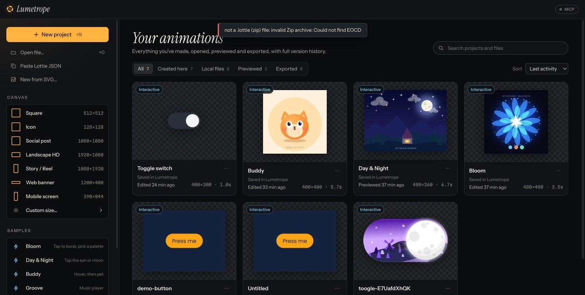
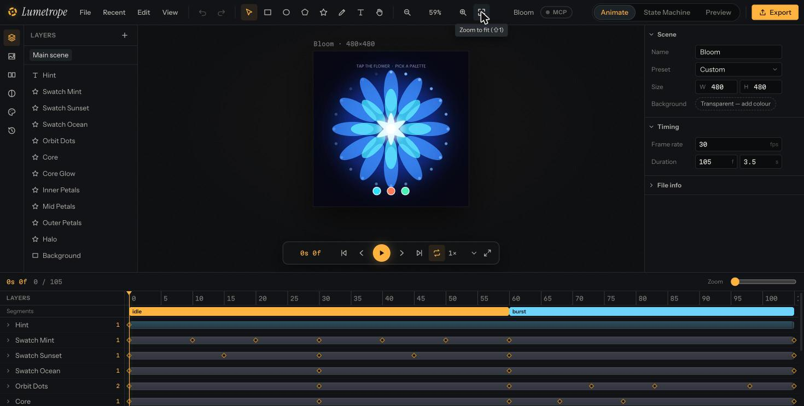
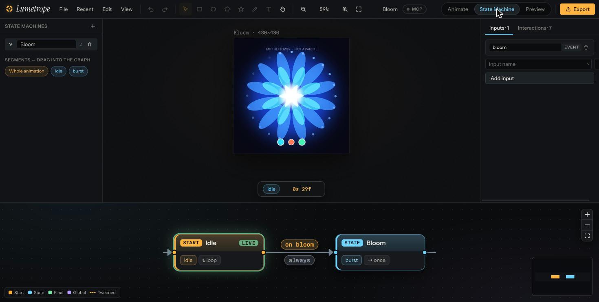
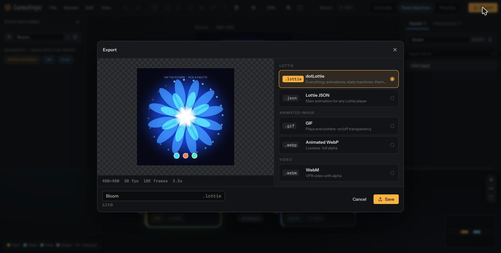

# Lumetrope

**An open-source creator *and* editor for Lottie and dotLottie animations**, with interactive
state machines, a GPU-accelerated canvas, local version history and an MCP server so AI agents
can animate alongside you. It runs in the browser and as a native desktop app for macOS, Windows
and Linux (Tauri).

> Lumetrope = *lumen* (light) + *-trope* (turning) — the family of optical toys (zoetrope,
> thaumatrope) that first made pictures move.

## Screenshots

| | |
|---|---|
|  |  |
| **Home** — your animations with version history, plus interactive samples | **Animate** — layers, canvas, properties and a keyframe timeline with segments |
|  |  |
| **State Machine** — node-graph editor for dotLottie 2.0 interactivity | **Export** — dotLottie, Lottie JSON, and transparent GIF / WebP / WebM |

## Features

**Create & edit**
- Shapes (rectangle, ellipse, polygon, star), pen tool with bezier handles, text, images, SVG and
  Lottie import, nested scenes (precomps), parenting, solids and nulls.
- Keyframes on every property, curve easing editor with presets and hold keys, motion paths,
  motion presets (fade, pop, slide, spin, bounce, shake, …) and staggering.
- Fills, strokes (caps, joins, dashes), linear/radial gradients, trim paths, round corners,
  repeaters, masks, track mattes (alpha/luma), blend modes, effects (drop shadow, gaussian blur,
  fill, tint, tritone).
- Timeline with layer bars, keyframe dragging and segment (marker) band; align/distribute,
  snapping, grid, copy/paste, undo/redo, context menus everywhere.
- Resizable left, right and timeline panes (drag the edges; double-click to reset).
- Full-screen player (F): fitted playback with scrubbing, speed, backgrounds, and interactive
  state-machine playback you can click.
- Lottie-Editor style quick edits: global recolouring of every colour, file info, canvas size,
  frame rate and duration.

**Interactive (dotLottie 2.0 state machines)**
- Node-graph editor for playback and global states, instant and tweened transitions, guards
  (numeric/string/boolean/event, `$input` references), inputs, interactions (click, pointer
  down/up/enter/exit/move, on complete, on loop complete) and every action type.
- Live preview: interact with the real animation, drive inputs, watch the event log.
- Themes and slots, exported to dotLottie `t/`.

**Export**
- dotLottie (everything, including state machines and themes) and Lottie JSON.
- Animated **GIF**, **WebP** and **WebM** with transparency: GIF uses a transparent palette index
  (soft edges blend into an edge-matte colour you choose), WebP is lossless with a full alpha
  channel, WebM is VP9/VP8 with an alpha stream. Pick size, frame rate, a segment or the whole
  animation, or flatten onto a background colour instead.

**Projects & files**
- Opens on a dashboard: start on the left (new project, custom size, canvas presets, open a file,
  paste Lottie JSON, new from SVG, samples, connect an AI agent) and every project you've created,
  opened, edited, previewed or exported on the right, with thumbnails, search and filters.
- Remembers where files live: paths in the desktop app (access survives restarts), File System
  Access handles in Chrome/Edge, a cached copy elsewhere. ⌘S writes back to the file, ⇧⌘S saves
  as a new one; outside changes are picked up when you reopen and kept in version history.

**Platform**
- Rust engine compiled to WebAssembly: lenient Lottie model, keyframe evaluator, renderer
  (tiny-skia CPU path + a display-list path executed on the GPU through Canvas2D), state machine
  runtime, dotLottie v1/v2 reader and v2 writer, hit testing, ~100 undoable editing tools.
- Local version control: save versions, restore, branch, diff — stored with autosave in the
  browser (IndexedDB), no server.
- **MCP**: `lumetrope-mcp` exposes 110+ tools (the full editing catalogue plus frame snapshots,
  history and state-machine testing) to Claude Code, Cursor, Codex and other MCP clients.
  WebMCP is registered too when the browser supports it.

## Repository layout

```
crates/core        lumetrope-core — the engine (pure Rust, fully tested)
crates/wasm        wasm-bindgen facade → apps/web/src/wasm
apps/web           the editor UI (React + TypeScript + Vite)
apps/desktop       Tauri v2 shell (macOS, Windows, Linux)
packages/mcp       lumetrope-mcp — stdio MCP server + WebSocket bridge to the app
docs/              research teardown, design spec and implementation plan
```

## Getting started

Prerequisites: Rust (stable) with the `wasm32-unknown-unknown` target, `wasm-pack`, Node 20+ and
pnpm. **[BUILD.md](BUILD.md)** has the full per-platform requirements and build guide for
macOS, Windows, Linux and WebAssembly.

```bash
rustup target add wasm32-unknown-unknown
cargo install wasm-pack
pnpm install
pnpm wasm          # build the engine to WebAssembly
pnpm dev           # http://localhost:5173
```

Open a file with **File ▸ Open**, drop a `.json`, `.lottie` or `.svg` on the canvas, or deep-link:
`http://localhost:5173/?open=/samples/shapes.json`. Four interactive demos (a mandala, a day/night landscape, a character and a music player)
are in [`samples/`](samples/).

### Desktop app

```bash
pnpm --filter @lumetrope/desktop dev             # live-reloading native window
pnpm --filter @lumetrope/desktop build:mac       # → .app + .dmg
pnpm --filter @lumetrope/desktop build:windows   # → .exe (NSIS) + .msi
pnpm --filter @lumetrope/desktop build:linux     # → .deb + .rpm + .AppImage
```

Build each platform on that platform (or let `.github/workflows/build.yml` build all three). System
libraries per OS are listed in [BUILD.md](BUILD.md).

### Connect an AI agent (MCP)

```bash
pnpm --filter lumetrope-mcp build
claude mcp add lumetrope -- node "$(pwd)/packages/mcp/dist/lumetrope-mcp.mjs"
```

(Windows PowerShell: `claude mcp add lumetrope -- node "$PWD\packages\mcp\dist\lumetrope-mcp.mjs"`.)

MCP needs the desktop app or a copy of Lumetrope served from your own machine (`localhost`); a
web copy deployed to a server hides MCP, because websites can't reach an MCP server on a visitor's
computer. Easiest: click the **MCP** badge in Lumetrope. It shows the exact command and config text for
your OS (Claude Code, Codex, Cursor, Claude Desktop) with the real server path; the desktop app
installs its own copy of the server, so no repository checkout is needed. Then turn on
**Local MCP**. Ask your agent to
“read the scene and add a bouncing ball with a hover state machine”. The server listens on
`ws://127.0.0.1:47321` (override with `LUMETROPE_MCP_PORT`) and only accepts local Lumetrope
windows.

## Tests

```bash
cargo test -p lumetrope-core          # engine: model, renderer + golden images, ops, SM, dotLottie, VCS
pnpm --filter @lumetrope/web test     # UI logic
pnpm --filter lumetrope-mcp test      # bridge + end-to-end stdio server
```

Interactive dotLottie files placed in `samples/lottiefiles/` (git-ignored) are picked up by the
engine's conformance tests and served by the dev server at `/samples/lottiefiles/…`.

## Shortcuts

On Windows and Linux use Ctrl wherever ⌘ is shown; menus show the right labels for your system.

| | |
|---|---|
| V R O P T H | select, rectangle, ellipse, pen, text, hand |
| Space (tap / hold) | play-pause / pan |
| ⌘Z ⇧⌘Z (Ctrl+Z, Ctrl+Shift+Z / Ctrl+Y) | undo / redo |
| ⌘C ⌘X ⌘V ⌘D ⌫ | copy, cut, paste, duplicate, delete |
| ⌘G | group into nested scene |
| , . | previous / next frame |
| F | play full screen |
| ⌘+ ⌘− ⇧1 ⇧0 ⇧2 | zoom in/out, fit, 100%, selection |
| ⌘S ⇧⌘S ⌥⌘S | save to file, save as, save version |
| ⌘N ⌘O ⌘E | new project, open, export |

## Clean-room note

Lumetrope is an independent implementation of the open Lottie and dotLottie 2.0 specifications.
It contains no code, assets or branding from LottieFiles; the feature teardown that informed the
design is in `docs/research/`.

## License

MIT — see [LICENSE](LICENSE). The bundled Poppins font is under the SIL Open Font License
(`crates/core/assets/OFL.txt`).
